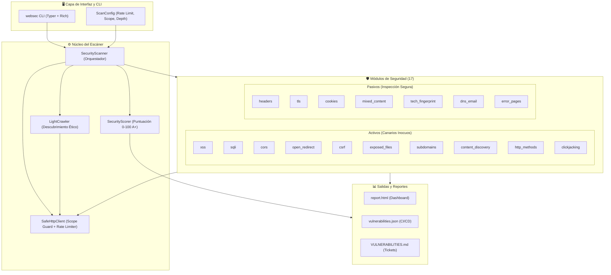

# 🛡️ WebSec Auditor

<div align="center">

[](https://www.python.org/)
[](https://docs.pytest.org/)
[](#-batería-de-pruebas-drásticas)
[](https://owasp.org/)
[](LICENSE)

<p align="center">
  <b>Herramienta profesional de auditoría de seguridad web ética, no destructiva y modular.</b><br>
  Diseñada para evaluar la postura defensiva de aplicaciones web mediante análisis activo con canarios inocuos, inspección pasiva exhaustiva y generación de reportes listos para remediación.
</p>

[Instalación](#-instalación-rápida) • [Uso de la CLI](#-ejemplos-de-uso) • [Catálogo de Módulos](#-catálogo-de-módulos-17) • [Pruebas Drásticas](#-batería-de-pruebas-drásticas) • [Laboratorio Local](#-laboratorio-vulnerable-local) • [Reportes](#-reportes-generados) • [Ética](#-reglas-éticas-obligatorias)

</div>

---

## 🌟 Características Principales

- 🎯 **17 Módulos de Auditoría Especializados**:
  - **Pruebas Activas No Destructivas**: Inyección de marcadores canarios únicos (XSS, SQLi Heuristic, Open Redirect, CORS Misconfigurations, Clickjacking, Formularios CSRF, Archivos Expuestos, Enumeración de Subdominios y Content Discovery).
  - **Análisis Pasivo Silencioso**: Inspección de cabeceras de seguridad (CSP, HSTS, X-Frame-Options), cookies con flags (`HttpOnly`, `Secure`, `SameSite`), Mixed Content & SRI, fingerprinting de tecnologías con cotejo de CVEs locales, registros DNS (SPF, DMARC, CAA) y detección de trazas de depuración (Stack Traces).
- 🛡️ **Control de Alcance y Protección Ética**:
  - Verificación estricta de dominios y subdominios autorizados (`Target.in_scope`).
  - Rate limiting regulable (por defecto 2 peticiones/segundo).
  - Confirmación obligatoria de autorización por escrito antes de emitir cualquier sondeo.
- 🧪 **Batería Drástica de 56 Pruebas (94% Cobertura)**:
  - Fuzzing basado en propiedades matemáticas con **Hypothesis**.
  - Inyección de caos de red y tolerancia a fallos.
  - Integración End-to-End real contra un laboratorio local vulnerable en vivo.
- 📋 **Reportes Multi-Formato Automatizados**:
  - `report.html`: Dashboard interactivo y visual autocontenido.
  - `vulnerabilities.json`: Formato estándar para pipelines de CI/CD.
  - `VULNERABILITIES.md`: Documento ejecutivo estructurado para crear issues directamente en GitHub o Jira.

---

## 🏛️ Arquitectura del Proyecto



---

## 🚀 Instalación Rápida

### Requisitos Previos
- **Python 3.11** o superior
- Administrador de paquetes `pip`

```bash
# 1. Clonar el repositorio
git clone https://github.com/14KD/web-sec.git
cd web-sec

# 2. Instalar el paquete en modo editable con herramientas de testeo
pip install -e ".[dev]"

# 3. Comprobar la instalación
websec --version
```

---

## 💻 Ejemplos de Uso

### 1. Auditoría Completa con Confirmación de Autorización
```bash
websec scan https://mi-dominio.com --i-have-permission
```
*(Si no pasas `--i-have-permission`, la CLI te pedirá confirmación explícita e interactiva antes de comenzar).*

### 2. Escaneo Focalizado en Módulos Críticos
```bash
websec scan https://mi-dominio.com --i-have-permission --modules headers,tls,xss,sqli,cors
```

### 3. Ajuste de Velocidad Ética, Profundidad y Directorio de Reportes
```bash
websec scan https://mi-dominio.com \
  --i-have-permission \
  --rate-limit 2.0 \
  --depth 2 \
  --format console,json,html,md \
  --output-dir ./reportes_auditoria
```

### 4. Consultar el Catálogo Completo de Módulos
```bash
websec list-modules
```

### 5. Verificar Base de Datos de CVEs y Componentes
```bash
websec update-db
```

---

## 🔍 Catálogo de Módulos (17)

### Módulos Pasivos (Inspección Segura)
| Módulo | Tipo | Descripción |
| :--- | :---: | :--- |
| `headers` | Pasivo | Audita cabeceras esenciales (CSP, HSTS, X-Frame-Options, Referrer-Policy, etc.). |
| `tls` | Pasivo | Inspecciona redirección HTTPS, validez de certificados y protocolos TLS. |
| `cookies` | Pasivo | Verifica flags de seguridad (`Secure`, `HttpOnly`, `SameSite`) en cookies de sesión. |
| `mixed_content` | Pasivo | Detecta recursos HTTP en páginas HTTPS y valida Subresource Integrity (SRI). |
| `tech_fingerprint` | Pasivo | Identifica servidores, frameworks y librerías contrastando con la base local de CVEs. |
| `dns_email` | Pasivo | Audita registros DNS defensivos: SPF, DMARC y CAA. |
| `error_pages` | Pasivo | Detecta fugas de rutas locales y mensajes con trazas de depuración (Stack Traces). |

### Módulos Activos (Detección con Canarios Inocuos)
| Módulo | Tipo | Descripción |
| :--- | :---: | :--- |
| `xss` | Activo | Inyecta marcadores canarios aleatorios (`wsa_xss_<id>`) para detectar reflejo sin codificar. |
| `sqli` | Activo | Sondeo heurístico de sintaxis SQL (MySQL, PostgreSQL, Oracle, SQLite, MSSQL). |
| `open_redirect` | Activo | Prueba parámetros de redirección (`?url=`, `?next=`) con URL de control externa segura. |
| `cors` | Activo | Detecta reflejo arbitrario de `Origin` o `null` con credenciales habilitadas. |
| `clickjacking` | Activo | Evalúa si la página permite enmarcado no autorizado en `<iframe>`. |
| `csrf` | Activo | Detecta formularios POST/PUT/DELETE que carecen de tokens de protección anti-CSRF. |
| `exposed_files` | Activo | Comprueba exposición de archivos críticos (`.git/HEAD`, `.env`, backups, etc.). |
| `content_discovery` | Activo | Mapeo ético y controlado de rutas comunes mediante wordlist ligera integrada. |
| `subdomains` | Activo | Descubrimiento pasivo vía Certificate Transparency (crt.sh) y verificación DNS. |
| `http_methods` | Activo | Consulta métodos HTTP habilitados mediante `OPTIONS` (TRACE, PUT, DELETE). |

---

## 🧪 Batería de Pruebas Drásticas

El proyecto implementa un estándar riguroso de calidad y seguridad con **56 pruebas** automatizadas:

```
tests/
├── test_fuzz_properties.py     # 🔬 Pruebas basadas en propiedades con Hypothesis
├── test_chaos_resilience.py    # 💥 Inyección de caos de red y tolerancia a fallos
├── test_e2e_lab.py             # 🎯 Integración End-to-End contra el laboratorio vulnerable
├── test_cli.py                 # 🖥️ Pruebas completas de interfaz de comandos
└── test_*.py                   # 🛡️ 40 pruebas unitarias con mocks HTTP (respx)
```

### Ejecutar las Pruebas

```bash
# Ejecutar la suite completa con cobertura
pytest -v --cov=websec

# 1. Pruebas de Fuzzing Matemático (Hypothesis)
pytest tests/test_fuzz_properties.py

# 2. Pruebas de Caos y Tolerancia a Fallos
pytest tests/test_chaos_resilience.py

# 3. Prueba End-to-End en Vivo contra el Laboratorio Real
pytest tests/test_e2e_lab.py
```

---

## 🧪 Laboratorio Vulnerable Local

Para realizar pruebas prácticas de forma 100% segura y controlada sin apuntar a la red pública:

```bash
# Terminal 1: Iniciar el servidor local intencionalmente vulnerable
python lab/app.py

# Terminal 2: Ejecutar la auditoría
websec scan http://127.0.0.1:5000 --i-have-permission
```

El auditor detectará automáticamente todas las vulnerabilidades programadas:
- Reflected XSS en `/search?q=test`
- Fuga de error de sintaxis SQL en `/product?id=1`
- Redirección abierta en `/redirect?url=...`
- CORS permisivo con credenciales en `/api/user`
- Cookies de sesión sin HttpOnly ni Secure en `/login`
- Formulario sensible sin token anti-CSRF en `/settings`
- Fuga de archivos confidenciales (`.git/HEAD`, `.env`)
- Exposición de trazas internas en `/debug-error`

---

## 📊 Reportes Generados

Al finalizar cada auditoría, los reportes se crean automáticamente en `reports/<dominio>-<timestamp>/`:

1. **`report.html`**: Tablero visual autocontenido con gráficos, calificación (A+ a F), puntuación de 0 a 100 y filtros dinámicos.
2. **`vulnerabilities.json`**: Estructura normalizada de vulnerabilidades para ingesta en sistemas de tickets, SIEM o CI/CD.
3. **`VULNERABILITIES.md`**: Informe estructurado con impacto, evidencia detallada y recomendaciones paso a paso para mitigación.

---

## ⚠️ Reglas Éticas Obligatorias

1. **Autorización Previa**: Utiliza esta herramienta únicamente en dominios propios o donde cuentes con permiso por escrito del propietario.
2. **Pruebas No Destructivas**: Ningún módulo intenta explotar vulnerabilidades, degradar servicios ni extraer datos privados.
3. **Límite de Tasa Responsable**: Respeta la disponibilidad de los servidores analizados aplicando límites de peticiones prudentes.

---

## 📁 Estructura del Repositorio

```
web-sec/
├── .github/workflows/ci.yml     # Pipeline automatizado de integración continua
├── docs/                        # Documentación técnica de arquitectura y módulos
├── examples/                    # Ejemplos de uso programático
├── lab/                         # Aplicación Flask deliberadamente vulnerable
├── src/websec/                  # Código fuente del motor auditor y catálogo de módulos
├── tests/                       # Suite de 56 pruebas (Fuzzing, Caos, E2E y Unitarias)
├── pyproject.toml               # Configuración de empaquetado y dependencias
├── README.md                    # Documentación principal del proyecto
└── LICENSE                      # Licencia MIT
```

---

## 📄 Licencia

Este proyecto está distribuido bajo la **Licencia MIT**. Consulta el archivo [LICENSE](LICENSE) para más detalles.
