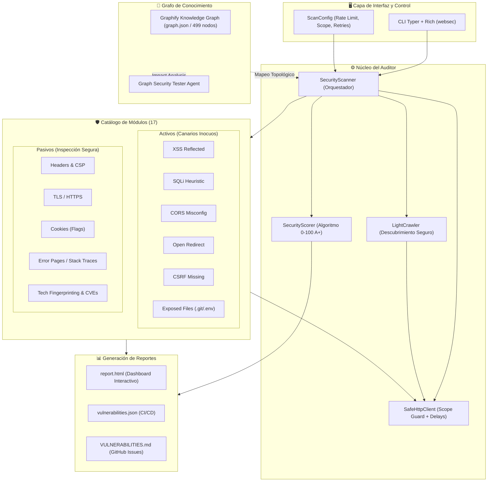

# 🛡️ WebSec Auditor & Knowledge Graph Security Engine

<div align="center">

[](https://www.python.org/)
[](https://docs.pytest.org/)
[](#-batería-de-pruebas-drásticas)
[](#-grafo-de-conocimiento-con-graphify)
[](https://owasp.org/)
[](LICENSE)

<p align="center">
  <b>Plataforma profesional y ética de auditoría de seguridad web, potenciada por grafos de conocimiento topológicos y testing de resiliencia drástico.</b>
</p>

[Instalación](#-instalación-rápida) • [Uso de la CLI](#-ejemplos-de-uso) • [Pruebas Drásticas](#-batería-de-pruebas-drásticas) • [Grafo Graphify](#-grafo-de-conocimiento-con-graphify) • [Agentes & Skills](#-ecosistema-de-agentes-y-skills) • [Laboratorio Local](#-laboratorio-vulnerable-local)

</div>

---

## 🌟 Características Principales

- 🎯 **17 Módulos Especializados**: Análisis activo y pasivo no destructivo (XSS con canarios, heurística SQLi, CORS, Open Redirect, Cookies, CSRF, TLS, Cabeceras, Subdominios, y más).
- 🧠 **Guiado por Grafo de Conocimiento (Graphify)**: Topología completa del código indexada en un grafo persistente de 499 nodos y 1,533 aristas para análisis de impacto y trazabilidad de dependencias.
- ⚡ **Testing Drástico Multi-Capa**: Fuzzing basado en propiedades con [Hypothesis](https://hypothesis.readthedocs.io/), inyección de caos y tolerancia a fallos, integración E2E en vivo y validación arquitectónica automática.
- 🤖 **Ecosistema de Agentes Autónomos**: Equipado con skills para auditorías OWASP Top 10, pentesting web seguro y auditoría arquitectónica asistida por IA.
- 📋 **Reportes Multi-Formato**: Generación simultánea de dashboards interactivos HTML, resúmenes ejecutivos en Markdown (`VULNERABILITIES.md`) y esquemas JSON listos para pipelines de CI/CD.

---

## 🏛️ Arquitectura del Sistema



---

## 🚀 Instalación Rápida

### Requisitos Previos
- **Python 3.11** o superior
- Administrador de paquetes `pip`

```bash
# 1. Clonar el repositorio
git clone https://github.com/14KD/web-sec.git
cd web-sec

# 2. Instalar el paquete en modo editable con herramientas de desarrollo
pip install -e "./web test[dev]"

# 3. Comprobar que la herramienta está lista
websec --version
```

---

## 💻 Ejemplos de Uso

### 1. Auditoría Completa con Confirmación Ética
```bash
websec scan https://mi-dominio.com --i-have-permission
```
*(Si omites `--i-have-permission`, la herramienta solicitará confirmación interactiva antes de emitir cualquier petición).*

### 2. Auditoría Focalizada en Módulos Críticos
```bash
websec scan https://mi-dominio.com --i-have-permission --modules headers,tls,xss,sqli,cors
```

### 3. Ajuste de Velocidad Ética, Profundidad y Directorio de Salida
```bash
websec scan https://mi-dominio.com \
  --i-have-permission \
  --rate-limit 2.0 \
  --depth 2 \
  --format console,json,html,md \
  --output-dir ./mis_reportes
```

### 4. Consultar el Catálogo de Módulos
```bash
websec list-modules
```

---

## 🧪 Batería de Pruebas Drásticas

WebSec Auditor cuenta con una arquitectura de pruebas rigurosa dividida en 4 capas de validación:

```
tests/
├── test_fuzz_properties.py     # 🔬 Fuzzing y pruebas basadas en propiedades (Hypothesis)
├── test_chaos_resilience.py    # 💥 Inyección de caos de red y tolerancia a fallos
├── test_e2e_lab.py             # 🎯 Integración End-to-End contra el laboratorio vulnerable
├── test_graph_driven.py        # 🧠 Validación arquitectónica contra el grafo de conocimiento
└── test_*.py                   # 🛡️ 40 pruebas unitarias con mocks de respx
```

### Comandos de Ejecución

```bash
# Ejecutar la suite completa de 56 tests con reporte de cobertura
pytest "web test/tests" -v --cov=websec

# 1. Ejecutar pruebas basadas en propiedades (Fuzzing)
pytest "web test/tests/test_fuzz_properties.py"

# 2. Ejecutar pruebas de ingeniería de caos
pytest "web test/tests/test_chaos_resilience.py"

# 3. Ejecutar integración E2E contra el laboratorio local en vivo
pytest "web test/tests/test_e2e_lab.py"

# 4. Ejecutar validaciones arquitectónicas guiadas por el grafo
pytest "web test/tests/test_graph_driven.py"
```

---

## 🧠 Grafo de Conocimiento con Graphify

El proyecto mantiene un grafo de conocimiento AST sincronizado en [`graphify-out/`](graphify-out/):

- **499 Nodos**: Clases, funciones, modelos, módulos de seguridad y tests.
- **1,533 Aristas**: Llamadas, herencias, importaciones y flujo de datos.
- **32 Comunidades**: Agrupaciones semánticas de código detectadas por conectividad.

### Comandos de Navegación del Grafo

```bash
# Consultar arquitectura o relaciones directamente en lenguaje natural
graphify query "how does SecurityScanner coordinate modules and SafeHttpClient?"

# Encontrar el camino de dependencias más corto entre dos componentes
graphify path "SecurityScanner" "Finding"

# Inspeccionar los detalles de un nodo específico y sus vecinos
graphify explain "SafeHttpClient"

# Abrir el visualizador interactivo 3D del grafo en el navegador
# Abre el archivo: graphify-out/graph.html
```

---

## 🤖 Ecosistema de Agentes y Skills

El proyecto integra skills para agentes de Inteligencia Artificial en [.agents/skills/](.agents/skills/):

- 🧠 **`graph-security-tester`**: Skill nativa que guía a agentes autónomos en la exploración topológica del grafo y coordinación de tests drásticos.
- 🐍 **`python-testing-patterns`**: Patrones avanzados de pruebas con `pytest`, fixtures de sesión y testing paramétrico.
- 🎯 **`web-app-penetration-testing`**: Metodología guiada para detección no destructiva de vectores de ataque.
- 🛡️ **`owasp-top-10-testing`**: Cobertura alineada con las categorías OWASP Top 10:2025.

---

## 🧪 Laboratorio Vulnerable Local

El proyecto incluye una aplicación web Flask deliberadamente vulnerable en [`web test/lab/app.py`](web%20test/lab/app.py) para evaluar el comportamiento del escáner en un entorno seguro y controlado:

```bash
# Terminal 1: Iniciar el laboratorio local
python "web test/lab/app.py"

# Terminal 2: Auditar el laboratorio
websec scan http://127.0.0.1:5000 --i-have-permission
```

El escáner detectará automáticamente:
- Reflected XSS en `/search?q=test`
- SQLi Error Heuristic en `/product?id=1`
- Open Redirect en `/redirect?url=...`
- CORS inseguro con credenciales en `/api/user`
- Cookies de sesión desprotegidas en `/login`
- Formularios sin token CSRF en `/settings`
- Fuga de información en `/.git/HEAD` y `/.env`
- Divulgación de depuración y stack traces en `/debug-error`

---

## ⚖️ Directrices Éticas y de Seguridad

> [!IMPORTANT]
> WebSec Auditor fue creado exclusivamente con propósitos de defensa, auditoría autorizada y educación. Las pruebas activas no envían exploits destructivos; únicamente emplean marcadores canarios de diagnóstico. El usuario es responsable de contar con la autorización explícita y por escrito de los propietarios del objetivo antes de ejecutar cualquier análisis.

---

## 📄 Licencia

Este proyecto está bajo la Licencia **MIT**. Consulta el archivo [LICENSE](web%20test/LICENSE) para más detalles.
