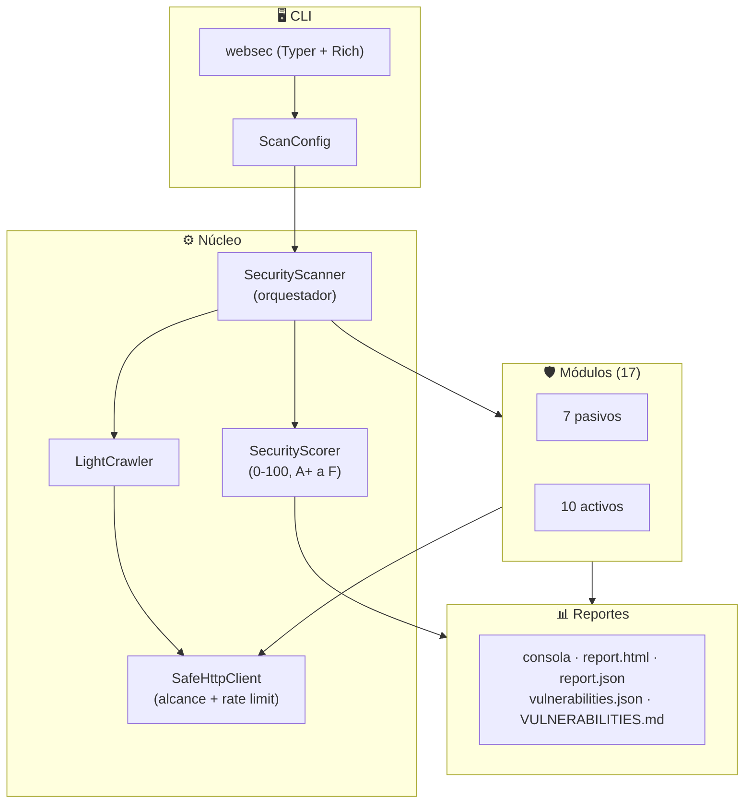

# 🛡️ WebSec Auditor

<div align="center">

[](https://github.com/14KD/web-sec/actions/workflows/ci.yml)
[](https://www.python.org/)
[](#-pruebas)
[](#-pruebas)
[](https://owasp.org/www-project-top-ten/)
[](LICENSE)

**Escáner de seguridad web ético, no destructivo y modular, escrito en Python.**

Combina inspección pasiva con sondas activas inocuas (marcadores canario) y genera reportes listos para remediar: consola, HTML, JSON y Markdown.

[Instalación](#-instalación) • [Uso](#-uso) • [Módulos](#-módulos-17) • [Reportes](#-reportes) • [Laboratorio](#-laboratorio-vulnerable-local) • [Pruebas](#-pruebas) • [Ética](#%EF%B8%8F-uso-ético)

</div>

> [!WARNING]
> Usa esta herramienta **solo** contra sistemas propios o con autorización escrita del propietario. Escanear sistemas ajenos sin permiso puede ser ilegal. Lee [ETHICS.md](ETHICS.md) antes de empezar.

---

## ✨ Características

- **17 módulos**: 7 pasivos y 10 activos, cubriendo cabeceras, TLS, cookies, XSS, SQLi, CORS, CSRF, redirecciones abiertas, archivos expuestos y más.
- **No destructivo**: las pruebas activas usan marcadores únicos e inofensivos (por ejemplo `wsa_xss_<id>`); ningún módulo explota vulnerabilidades ni extrae datos.
- **Control de alcance estricto**: cada petición pasa por `Target.in_scope`, que bloquea otros dominios, dominios parecidos y esquemas no HTTP. Los subdominios solo entran con `--allow-subdomains`.
- **Tráfico limitado**: 2 peticiones por segundo por defecto, con reintentos y timeouts configurables.
- **Puntuación de 0 a 100** con calificación de A+ a F.
- **Reportes** en consola (Rich), HTML interactivo, JSON y Markdown para crear issues.

---

## 🏛️ Arquitectura



Más detalle en [docs/architecture.md](docs/architecture.md) y [docs/modules.md](docs/modules.md).

---

## 🚀 Instalación

Requisitos: **Python 3.11 o superior** y `pip`.

```bash
git clone https://github.com/14KD/web-sec.git
cd web-sec

# Instalación normal
pip install -e .

# O con las herramientas de desarrollo (pytest, hypothesis, respx, flask para el laboratorio)
pip install -e ".[dev]"

websec --version
```

---

## 💻 Uso

### Auditoría completa

```bash
websec scan https://mi-dominio.com --i-have-permission
```

Si omites `--i-have-permission`, la CLI pide confirmación interactiva y cancela el escaneo si respondes que no.

### Solo algunos módulos

```bash
websec scan https://mi-dominio.com --i-have-permission -m headers,tls,xss,sqli,cors
```

### Ajustar velocidad, profundidad y salida

```bash
websec scan https://mi-dominio.com \
  --i-have-permission \
  --rate-limit 1.0 \
  --depth 1 \
  --timeout 15 \
  --format console,html \
  --output-dir ./reportes
```

### Otros comandos

```bash
websec list-modules   # Lista los 17 módulos disponibles
websec update-db      # Verifica la base local de componentes vulnerables (no descarga nada)
```

### Opciones de `websec scan`

| Opción | Corta | Defecto | Descripción |
| :--- | :---: | :---: | :--- |
| `--i-have-permission` | | `false` | Confirma que tienes autorización escrita. Sin ella, se pide confirmación. |
| `--modules` | `-m` | todos | Módulos separados por comas. |
| `--depth` | `-d` | `2` | Profundidad de rastreo (0 a 5). |
| `--rate-limit` | `-r` | `2.0` | Peticiones por segundo (0.1 a 50). |
| `--format` | `-f` | `console,json,html,md` | Formatos de salida. |
| `--output-dir` | `-o` | `reports/<dominio>-<fecha>/` | Carpeta de los reportes. |
| `--allow-subdomains` | | `false` | Incluye subdominios del objetivo en el alcance. |
| `--timeout` | | `10.0` | Segundos de espera por petición. |

### Uso desde Python

Consulta [examples/sample_scan.py](examples/sample_scan.py): crea un `ScanConfig`, registra los módulos en `SecurityScanner` y llama a `run()`.

---

## 🔍 Módulos (17)

### Pasivos (solo leen las respuestas)

| Módulo | Qué revisa |
| :--- | :--- |
| `headers` | Cabeceras de seguridad: CSP, HSTS, X-Frame-Options, Referrer-Policy, etc. |
| `tls` | Redirección a HTTPS, certificado y versión de TLS. |
| `cookies` | Flags `Secure`, `HttpOnly` y `SameSite`. |
| `mixed_content` | Recursos HTTP en páginas HTTPS y Subresource Integrity (SRI). |
| `tech_fingerprint` | Servidores, frameworks y librerías, cruzados con una base local de CVEs. |
| `dns_email` | Registros SPF, DMARC y CAA. |
| `error_pages` | Trazas de depuración y rutas internas en páginas de error. |

### Activos (envían sondas inocuas)

| Módulo | Qué revisa |
| :--- | :--- |
| `xss` | Reflejo sin codificar de un marcador en parámetros y formularios GET. |
| `sqli` | Mensajes de error SQL (MySQL, PostgreSQL, Oracle, SQLite, MSSQL) ante caracteres de sintaxis. |
| `open_redirect` | Parámetros como `?url=` o `?next=` que redirigen a dominios externos. |
| `cors` | `Origin` arbitrario o `null` reflejado con credenciales habilitadas. |
| `clickjacking` | Páginas que se pueden incrustar en un `<iframe>`. |
| `csrf` | Formularios POST, PUT o DELETE sin token anti-CSRF. |
| `exposed_files` | Archivos sensibles accesibles (`.git/HEAD`, `.env`, copias de seguridad). |
| `content_discovery` | Rutas comunes a partir de una lista de palabras pequeña. |
| `subdomains` | Subdominios vía Certificate Transparency (consulta a crt.sh) y DNS. |
| `http_methods` | Métodos habilitados (TRACE, PUT, DELETE) mediante `OPTIONS`. |

---

## 📊 Reportes

Se guardan en `reports/<dominio>-<fecha>/`, o en la carpeta que indiques con `--output-dir`:

| Archivo | Cuándo se genera | Contenido |
| :--- | :--- | :--- |
| `report.html` | Con `--format html` | Panel autocontenido con puntuación, gráficos y filtros. |
| `report.json` | Con `--format json` | Resultado completo del escaneo. |
| `vulnerabilities.json` | Siempre | Lista plana de hallazgos para CI/CD o SIEM. |
| `VULNERABILITIES.md` | Siempre | Hallazgos agrupados por severidad, listos para issues de GitHub o Jira. |

La salida en consola se muestra con `--format console`.

---

## 🧪 Laboratorio vulnerable local

`lab/app.py` es una aplicación Flask **intencionalmente vulnerable** para practicar sin tocar sistemas reales. Solo escucha en `127.0.0.1`.

```bash
# Terminal 1 (requiere flask: pip install -r lab/requirements.txt)
python lab/app.py

# Terminal 2
websec scan http://127.0.0.1:5000 --i-have-permission
```

Vulnerabilidades incluidas:

| Ruta | Vulnerabilidad |
| :--- | :--- |
| `/search?q=` | XSS reflejado |
| `/product?id=` | Error de sintaxis SQL expuesto |
| `/redirect?url=` | Redirección abierta |
| `/api/user` | CORS permisivo con credenciales |
| `/login` | Cookie de sesión sin `Secure` ni `HttpOnly` |
| `/settings` | Formulario POST sin token CSRF |
| `/.git/HEAD`, `/.env` | Archivos sensibles expuestos |
| `/debug-error` | Traza de depuración visible |

La prueba `tests/test_e2e_lab.py` levanta este laboratorio y verifica que el escáner detecta XSS, SQLi, CORS, CSRF, cookies y páginas de error, con una calificación de C o peor.

---

## 🧪 Pruebas

67 pruebas con 96% de cobertura. El CI las ejecuta en Python 3.11, 3.12 y 3.13.

```
tests/
├── test_security_properties.py  # Propiedades de seguridad con Hypothesis (alcance, esquemas, puntuación)
├── test_fuzz_properties.py      # Fuzzing de puntuación, alcance, serialización y parsing HTML
├── test_chaos_resilience.py     # Fallos de red: TCP RST, bucles de redirección, timeouts, respuestas enormes
├── test_e2e_lab.py              # Escaneo real contra el laboratorio Flask
├── test_cli.py                  # Comandos de la CLI
├── test_graph_driven.py         # Auditoría con graphify (se omite si no existe graphify-out/graph.json)
└── test_<módulo>.py             # Pruebas unitarias por módulo con mocks HTTP (respx)
```

```bash
pytest --cov=websec                       # Suite completa con cobertura
pytest tests/test_security_properties.py  # Solo propiedades de seguridad
pytest tests/test_e2e_lab.py              # Solo la prueba contra el laboratorio
```

---

## ⚖️ Uso ético

1. **Autorización previa**: solo dominios propios o con permiso escrito del propietario.
2. **Sin daño**: ningún módulo explota fallos, degrada servicios ni extrae datos privados.
3. **Tráfico moderado**: respeta los límites de peticiones y no los subas sin motivo.

Consulta [ETHICS.md](ETHICS.md) y [docs/ethical_guidelines.md](docs/ethical_guidelines.md).

---

## 📁 Estructura

```
web-sec/
├── .github/workflows/ci.yml   # CI: pruebas en Python 3.11-3.13
├── docs/                      # Arquitectura, módulos, guía ética y página web
├── examples/                  # Uso programático
├── lab/                       # Laboratorio Flask vulnerable
├── src/websec/
│   ├── core/                  # Escáner, cliente HTTP, crawler, modelos, puntuación
│   ├── modules/               # Módulos activos y pasivos
│   ├── reports/               # Generadores de reportes y plantilla HTML
│   └── data/                  # Rutas sensibles, librerías vulnerables, lista de palabras
├── tests/
├── CONTRIBUTING.md
├── ETHICS.md
└── pyproject.toml
```

---

## 🤝 Contribuir

Lee [CONTRIBUTING.md](CONTRIBUTING.md) para añadir módulos nuevos, el estilo de código y la política de pruebas.

## 📄 Licencia

[MIT](LICENSE)
